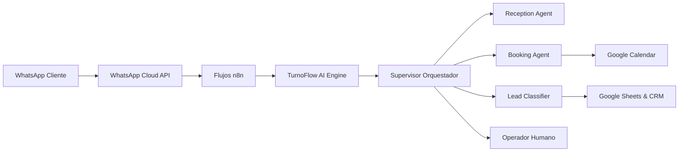

# 01. INTRODUCCIÓN A TURNOFLOW AI

## La Problemática de los Negocios de Belleza y Estética
En el día a día de un centro de estética o salón de belleza, el 70% de las consultas comerciales ocurren por WhatsApp e Instagram. Sin embargo:
- Las clientas consultan de noche o durante fines de semana, cuando el centro está cerrado.
- Las especialistas están ocupadas atendiendo cabinas y no pueden contestar el teléfono.
- La demora promedio en responder es de 2 a 6 horas; para entonces, la clienta ya reservó en otro lugar.
- No existe un seguimiento sistemático a quienes pidieron lista de precios pero no confirmaron.

## La Solución: TurnoFlow AI
TurnoFlow AI no es un chatbot tosco con botones rígidos de opciones. Es un sistema integral de **Recepción Inteligente 24/7** compuesto por agentes especializados con memoria contextual y acceso seguro a herramientas:
- **Responde en menos de 5 segundos** cualquier duda sobre servicios, tarifas y ubicación.
- **Clasifica el interés comercial** (frío, tibio, caliente) y detecta oportunidades inmediatas.
- **Verifica disponibilidad real** en Google Calendar antes de confirmar citas para evitar solapamientos.
- **Ejecuta seguimientos automáticos** respetando las políticas del negocio y los horarios comerciales.
- **Deriva a operadores humanos** con un solo clic o de forma automática ante consultas complejas o reclamos.

